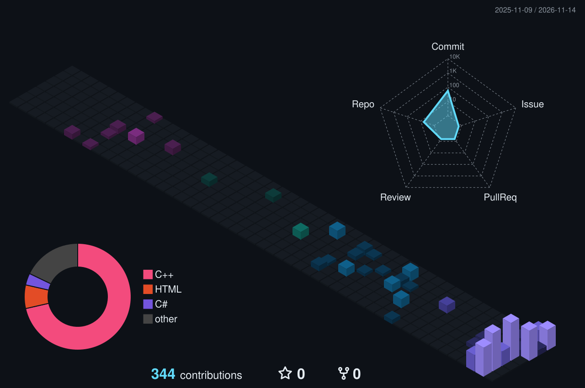

<h1 align="center">Hi, I'm Jhon Lee Quint</h1>

  

  
  
  

## About me

- Business administrator with postgraduate degrees in Software Engineering and in Automation and Process Engineering.
- I build software for electronics manufacturing: hourly production monitoring, automated optical inspection with YOLO, barcode and label systems, and the ESP32 firmware that connects the line to them.
- Most of my production work runs offline, on the shop floor network, next to the people who use it every shift.
- Based in Joinville, Brazil.

## Languages and tools

  

## Featured projects

| Project | What it is | Stack |
|---|---|---|
| [hourly-production-monitoring](https://github.com/jhonleequint/hourly-production-monitoring) | Production line monitoring, from an Arduino prototype to ESP32 operator stations, a serial gateway and a desktop dashboard | C++, ESP32, Python, Electron |
| [offline-label-generator](https://github.com/jhonleequint/offline-label-generator) | Label designer that runs entirely in the browser, without internet | JavaScript |
| [network-management-tools](https://github.com/jhonleequint/network-management-tools) | Windows tools for local network diagnostics and a TCP bridge between subnets | Batch, C# |
| [arduino-led-matrix-tetris](https://github.com/jhonleequint/arduino-led-matrix-tetris) | Tetris on eight MAX7219 LED matrices with score display and sound | C++, Arduino |
| [esp32-oled-frame-animation](https://github.com/jhonleequint/esp32-oled-frame-animation) | Frame-by-frame bitmap animation on an SSD1306 OLED | C++, ESP32 |

Other work, kept private: an AOI station with YOLO OBB and ESP32 actuator, a maintenance and engineering system (web and mobile), serial number control, and Windows services that feed production data to the central MES.

## GitHub stats

  
  

  

## Contributions

  <picture>
    <source media="(prefers-color-scheme: dark)" srcset="https://raw.githubusercontent.com/jhonleequint/jhonleequint/output/github-snake-dark.svg" />
    <source media="(prefers-color-scheme: light)" srcset="https://raw.githubusercontent.com/jhonleequint/jhonleequint/output/github-snake.svg" />
    
  </picture>

  

