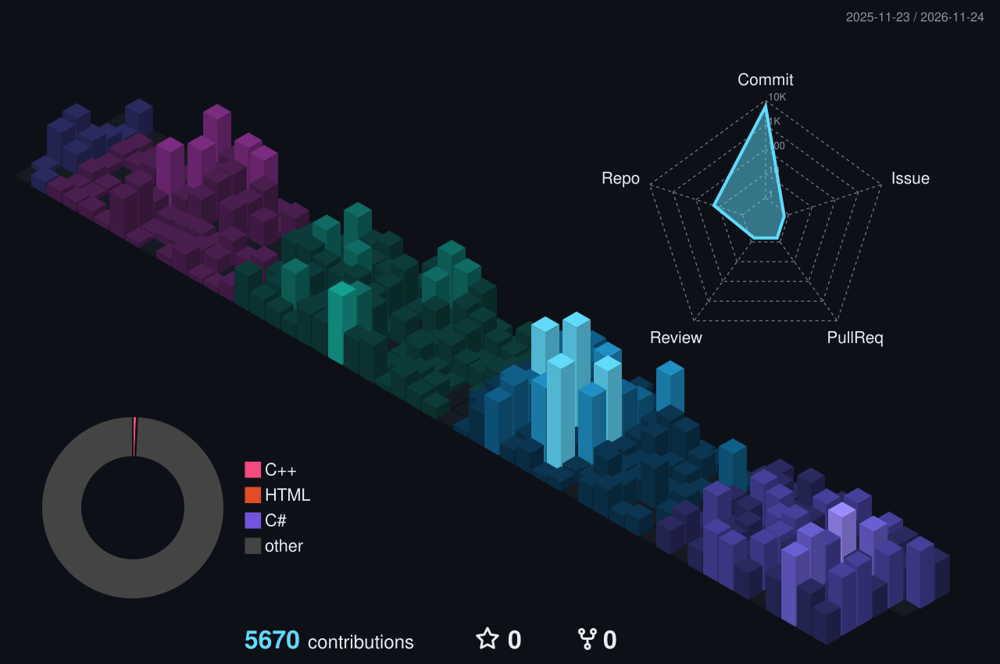

<h1 align="center">Hi, I'm Jhon Lee Quint</h1>

Software development · Joinville, Brazil

  

  

## Languages and tools

  

## Featured projects

| Project | What it is | Stack |
|---|---|---|
| [hourly-production-monitoring](https://github.com/jhonleequint/hourly-production-monitoring) | Production line monitoring, from an Arduino prototype to ESP32 operator stations, a serial gateway and a desktop dashboard | C++, ESP32, Python, Electron |
| [offline-label-generator](https://github.com/jhonleequint/offline-label-generator) | Label designer that runs entirely in the browser, without internet | JavaScript |
| [network-management-tools](https://github.com/jhonleequint/network-management-tools) | Windows tools for local network diagnostics and a TCP bridge between subnets | Batch, C# |
| [arduino-led-matrix-tetris](https://github.com/jhonleequint/arduino-led-matrix-tetris) | Tetris on eight MAX7219 LED matrices with score display and sound | C++, Arduino |
| [esp32-oled-frame-animation](https://github.com/jhonleequint/esp32-oled-frame-animation) | Frame-by-frame bitmap animation on an SSD1306 OLED | C++, ESP32 |

## Private work

The source code of these projects is private. Their commits are part of the contribution graph below.

| Project | What it is | Stack |
|---|---|---|
| visual-inspection-system | Automated optical inspection station for PCB assembly lines, with a recipe manager and an ESP32 actuator | Python, FastAPI, OpenCV, YOLO, ESP32 |
| sector-control-system | Maintenance and engineering system with an offline-first web app and mobile app | TypeScript, Next.js, Express, PostgreSQL, Capacitor |
| hourly-production-monitoring-desktop | Desktop application of the hourly production monitoring system | JavaScript, Electron, Node.js |
| serial-number-manager | Serial number control with a label designer and network diagnostics | C#, Blazor, PostgreSQL |
| barcode-defect-reader | Windows tray app that records production defects from barcode reads | C# |
| bz-data-collection-module | Windows service that collects packing line output and sends production events | C# |

## Activity

  

  

## Contributions

  <picture>
    <source media="(prefers-color-scheme: dark)" srcset="https://raw.githubusercontent.com/jhonleequint/jhonleequint/output/github-snake-dark.svg" />
    <source media="(prefers-color-scheme: light)" srcset="https://raw.githubusercontent.com/jhonleequint/jhonleequint/output/github-snake.svg" />
    
  </picture>

  

